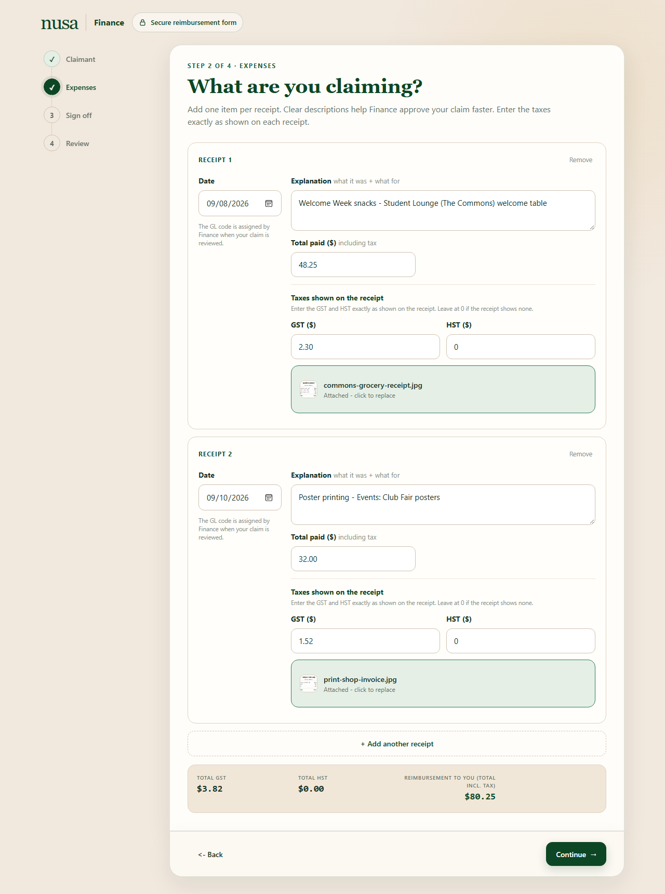
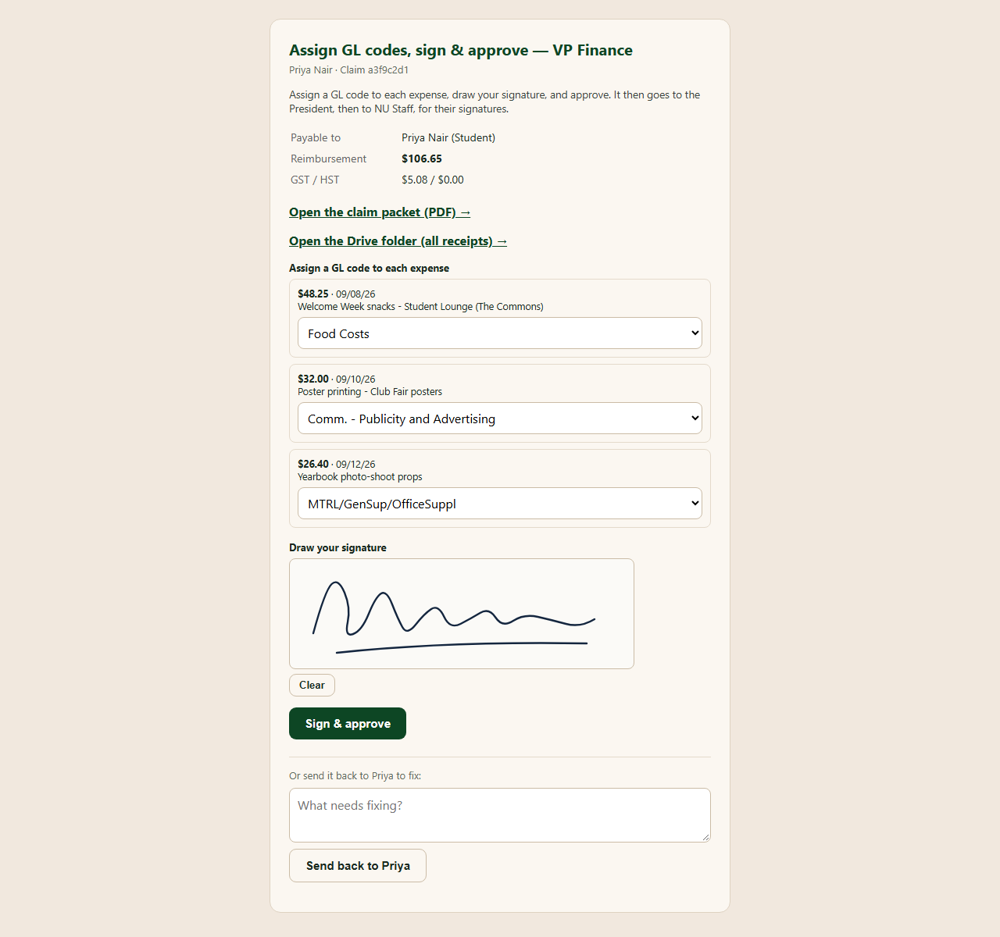
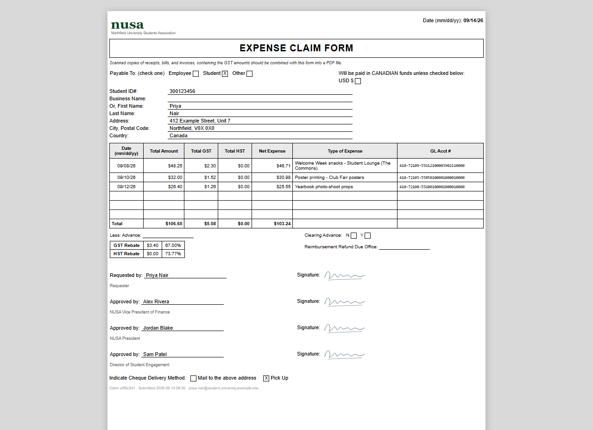
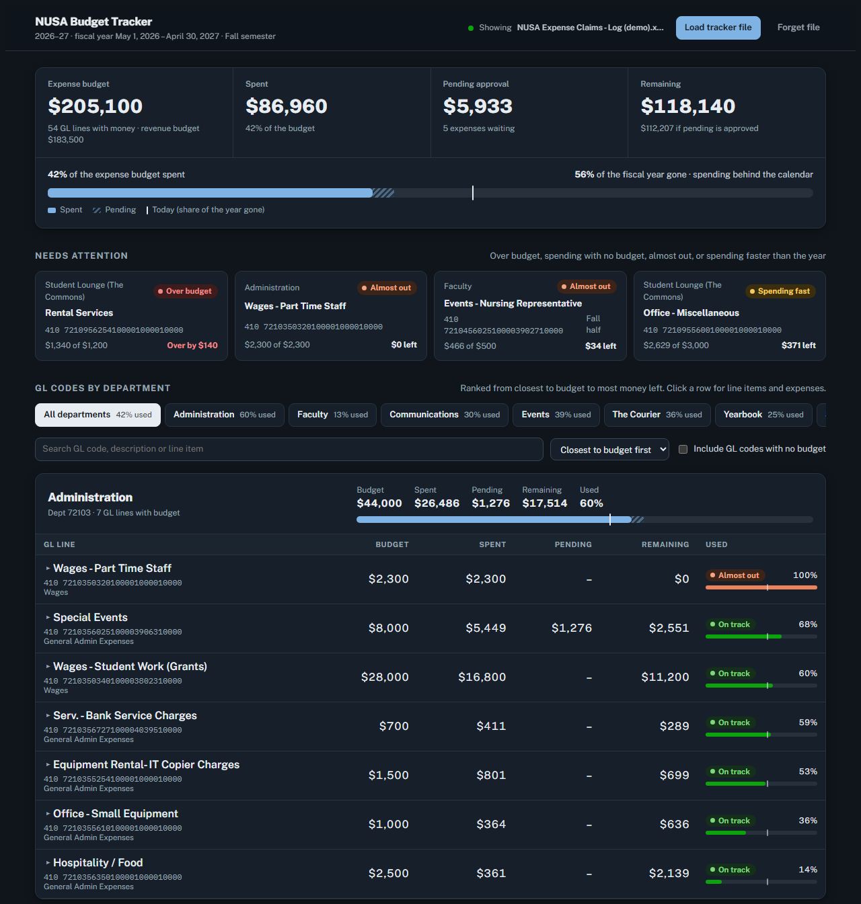

# Student Association Finance System

An online expense-claim, approval and budget-tracking system for a students' association, built on Google Apps Script, Google Sheets and Drive, with a Python pipeline that turns the annual budget workbook into a live budget tracker.

## Context

Built for my university's students' association while I was serving as VP Finance (2026-27). Before this, expense claims were paper forms with wet signatures that travelled between four people, receipts got lost, and the budget was tracked by hand in a spreadsheet that was always a few weeks behind. The system replaces that with one web form, signatures on screen, an automatic audit trail, and a tracker that shows budget versus spent versus pending by GL code at any moment.

**All data in this repository is fictional.** The organisation is "NUSA" (Northfield University Students' Association). Names, emails, GL codes and budget figures are made up for the demonstration and do not describe a real organisation.

## What it does

- **Online claims.** Students submit expense claims and kilometre (mileage) reimbursement claims through a guided web form. Mileage is calculated as km x rate plus parking.
- **Receipt uploads.** Images and PDFs are accepted. PDF receipts are converted to page images in the browser (pdf.js) and printed inside the claim PDF, so the approver sees one complete packet.
- **Approval chain with on-screen signatures.** Requester, then VP Finance (signs and assigns GL/budget codes), then President, then a university staff signer, then the final signed PDF goes to VP Finance for Accounts Payable.
- **University staff step by email.** The university mail server rejects automated Gmail, so the system emails the packet to the VP, who sends it on and forwards the signed reply back. A time-driven trigger watches Gmail, files the signed PDF in the claim's folder and updates the claim.
- **Tokenised signing links.** Each signer gets a one-time link; no Google account is needed to sign.
- **Send back for changes.** The approver can return a claim with a note. The student gets an edit link that reopens the claim pre-filled and resubmits it under the same claim ID.
- **Automatic reminders** when a claim has waited 5, 7 and 14 days at the same step, plus menu actions to email a digest of claims awaiting signature and to remind the President or students with sent-back claims.
- **Expense Ledger as the database.** Every claim line becomes one row in a Google Sheet. Manual entries (paper claims, card statements) go in through a sidebar; claim-tracking dropdowns record "submitted to AP / cheque received / picked up".
- **Live budget tracker.** Dashboard, charts, GL Budget, Line Items and more, driven by thousands of formulas keyed by GL code, with a per-semester view for one department.
- **Budget pipeline and web dashboard.** Python parses the annual budget workbook and generates the tracker's data file; a standalone HTML dashboard reads a downloaded export of the Sheet in the browser.
- **Owner-only maintenance tools**, for example correcting wrong GL codes on a claim before the President has signed (rebuilds the PDF, rewrites ledger rows, re-sends the signing link).

## Architecture

```mermaid
flowchart LR
  S[Student] --> W[Claim web app<br/>Apps Script + Form.html]
  W --> A1[VP Finance signs,<br/>assigns GL codes]
  A1 --> A2[President signs]
  A2 -->|PDF by email via VP| A3[University staff signs PDF]
  A3 -->|Gmail watcher files reply| F[Final signed PDF<br/>to VP Finance / AP]
  W --> D[(Drive: per-claim folders<br/>receipts + PDF packet)]
  A3 --> D
  W --> L[(Expense Ledger<br/>Google Sheet)]
  M[VP: manual expenses<br/>sidebar] --> L
  L --> T[Budget tracker tabs<br/>Dashboard, GL Budget, ...]
  B[Annual budget workbook<br/>.xlsx] --> P[Python pipeline]
  P --> TD[TrackerData.gs]
  TD --> T
  L -. .xlsx export .-> H[HTML dashboard]
```

More detail, including the claim statuses and the ledger columns, is in [docs/architecture.md](docs/architecture.md).

## Tech stack

- Google Apps Script (V8): web app, time-driven triggers, Gmail, Drive and Sheets services, HtmlService (HTML to PDF)
- Google Sheets formulas (SUMIFS, lookups) for the tracker
- HTML, CSS and vanilla JavaScript for the form and dashboard; pdf.js for PDF receipts
- Python 3 for the budget pipeline (reads the Excel budget workbook)
- Node.js for tests, with hand-written mocks of the Google services

## Repository layout

```
apps-script/
  claim-web-app/        Standalone web app project
    Code.gs               Backend: submission, approval chain, PDFs, reminders, ledger writes
    Form.html             Claim form, decision pages and signature pads (front end)
    appsscript.json       Manifest: OAuth scopes, web app settings
  sheet-tools/          Script bound to the Google Sheet
    Tracker.gs            Builds the budget tracker tabs and formulas
    TrackerData.gs        Generated budget data (output of the Python pipeline)
    ManualExpense.gs      Custom menu + sidebar backend for manual expenses
    ManualExpenseSidebar.html
    ClaimTracking.gs      Dropdown columns that copy across a claim's rows
    GlCodes.gs            Maintains the GL List tab
    UnsignedClaims.gs     Email digest of claims waiting for signature
    PresidentReminders.gs Reminder email to the President
    SentBackReminders.gs  Reminder emails for claims sent back for changes
budget-pipeline/        Python: budget workbook -> tracker data
  parse.py                Reads department tabs into GL lines and line items, ties to the P&L
  build2.py               Builds the tracker data model
  gsheet_export.py        Writes TrackerData.gs
  gl_master_gsheet.py     Writes GlCodes.gs from the GL master list
dashboard/              Standalone HTML budget dashboard
  dashboard_template.html
  export.py               Embeds a budget snapshot into the template
tests/                  Node test suites against simulated Google services
docs/                   Architecture notes and screenshots
```

## Running the tests

Requires Node.js. The tests use only built-in modules (`fs`, `vm`, `assert`), so there is nothing to `npm install`.

```
node tests/test_approvals.js      # approval chain, signed-PDF watcher, send-back and resubmit
node tests/test_ledger.js         # Expense Ledger writes and status sync
node tests/test_tracker.js        # tracker tabs and every formula written
node tests/test_tracking.js       # claim-tracking dropdown columns
node tests/test_manual.js         # manual expense sidebar backend
node tests/test_gllist.js         # GL List maintenance
node tests/test_unsigned.js       # unsigned-claims digest
node tests/test_sentback.js       # sent-back reminders
node tests/test_president.js      # President reminders
```

`tests/paths.js` says where each script file is loaded from; adjust it if you move files.

## Setting it up

These are the general steps; the code has more detail in its header comments.

1. Create a Google Sheet for the claim log. It will hold the Claims log, Expense Ledger and GL List tabs.
2. Create a standalone Apps Script project for the web app. Add `Code.gs` and `Form.html` (named `Form`) and replace the manifest with `appsscript.json`.
3. Fill in `CONFIG` at the top of `Code.gs` (approver names and emails, Drive folder, organisation name). Run `setupExpenseLedger` once, and `refreshGlList` after any change to the GL list.
4. Deploy as a web app (Deploy > New deployment). Copy the stable `/exec` URL into `CONFIG.WEB_APP_URL` and redeploy.
5. Run `installDailyReminderTrigger` and `installSignedPdfWatcher` once to schedule reminders and the Gmail watcher.
6. Open the Sheet's Extensions > Apps Script and add the `sheet-tools` files (the sidebar as `Sidebar`). Run `addClaimTrackingColumns`, `updateGlList` and `buildBudgetTracker` once. Reload the Sheet to get the custom menu.
7. After a budget change, run the Python pipeline to regenerate `TrackerData.gs`, paste it in and run `rebuildBudgetTracker`.

OAuth scopes in `appsscript.json`: Drive, Spreadsheets, Gmail (send, plus full Gmail access to read the signed-PDF replies), external requests, script triggers, sending mail, and the user's email address. The web app executes as the deploying user and is open to anonymous visitors, because signers and students do not need Google accounts.

## Design decisions and what I learned

- **The Sheet is the database.** The finance team already lives in spreadsheets, can read and correct the data themselves, and needs no hosting. The cost is discipline: one row per expense line, fixed column order, and a "Locked" flag so the claim system never overwrites a hand-corrected row.
- **Tokenised links instead of Google accounts.** Signers include people outside the Google ecosystem. A one-time token in the link, rotated at each step, keeps the chain secure without forcing logins, and sent-back claims reuse the same mechanism for their edit link.
- **The staff step goes through email.** The university mail server rejects automated Gmail, so a fully automated hand-off was impossible. I made the human step explicit: the system gives the VP the PDF and the exact message, and picks up the signed reply with a trigger.
- **Tests run against mocks.** Apps Script has no local runtime, so the Node tests load the real source into a VM with simulated SpreadsheetApp, DriveApp, GmailApp and friends. They catch logic and structure errors (including mistyped method names) but not Google's formula evaluation, which I checked in the real Sheet.
- **The budget is generated, not typed.** The tracker is keyed by GL code and built from the budget workbook, with a tie-out to the P&L totals. When the budget changes, I regenerate rather than edit formulas, and a rebuild puts back manual budget edits unless the new budget changed the same line.
- **Plan for failure at each step.** Reminders at 5, 7 and 14 days, unmatched-reply notifications and owner-only repair functions exist because real claims get stuck in real ways.

## My role

I designed the claim and approval workflow with the executive team, built and maintained the system, and ran it live for the 2026-27 year as VP Finance.

Built with the help of an AI coding assistant (Claude); I designed the workflow, made the decisions, tested it and ran it in production.

<!-- TODO: add numbers, e.g. claims processed / time saved -->

## Screenshots

All screenshots use fictional demo data (NUSA, invented names, example addresses).


*The student claim form, expenses step, with two receipts attached.*


*VP Finance assigns a GL code to each expense, draws a signature and approves.*


*The generated claim PDF with GL codes and all four signatures.*


*The standalone budget dashboard loaded with demo spending.*

## License

MIT. See [LICENSE](LICENSE).
